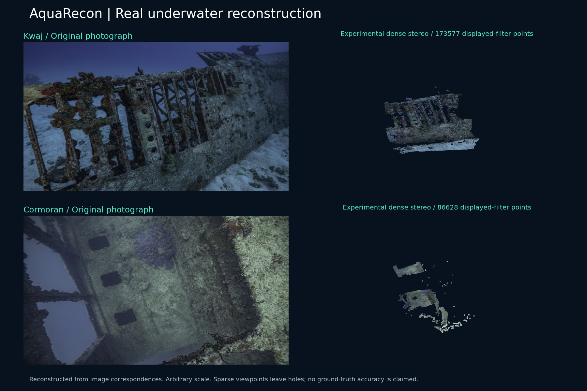
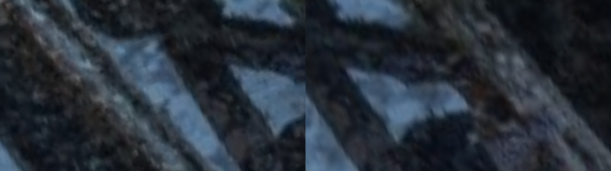
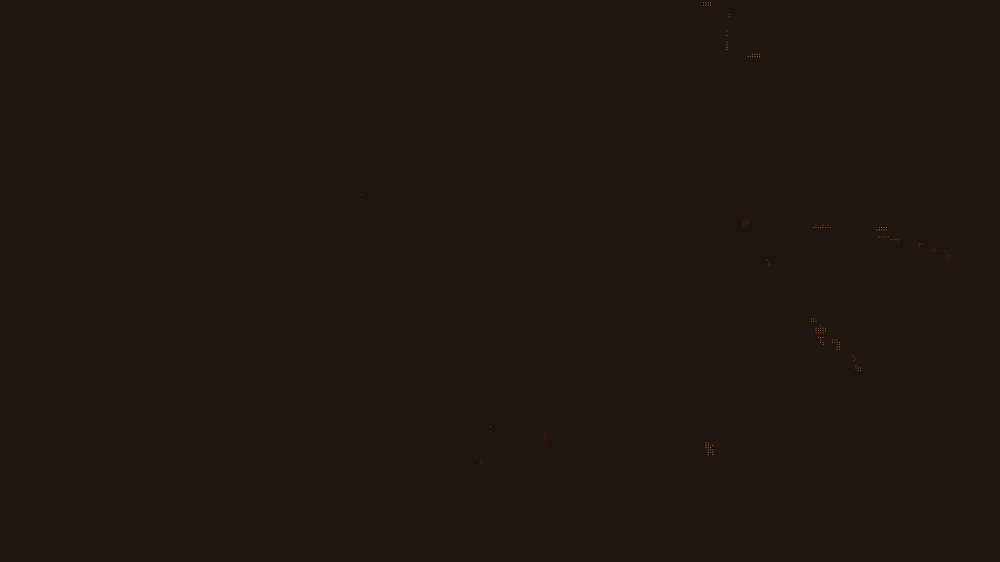
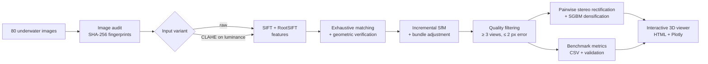

<div align="center">

# AquaRecon
### Underwater Stereo and Multi-View 3D Reconstruction of Shipwrecks

**Hazem NEFZI** · Innovative Mechanisms and Robots (IMR), SIGMA Clermont

[](https://hazem-nefzi.github.io/AquaRecon-Underwater-3D-Reconstruction/AquaRecon.html)




</div>

---

## Overview

AquaRecon reconstructs **real deep-sea shipwrecks in 3D** from **80 underwater photographs** (4 scenes × 20 images, 720p). It recovers camera poses and sparse 3D structure with **structure-from-motion and bundle adjustment**, densifies the geometry with **pairwise stereo matching**, and lets you inspect every result in an **interactive 3D viewer** that runs directly in the browser.

The project also asks a practical question: **does contrast enhancement help underwater reconstruction?** Each scene is reconstructed twice, from the raw images and from CLAHE-enhanced images, and the results are compared with quantitative metrics.

> **Scope.** AquaRecon targets the *visual survey stage* of underwater inspection: recover the visible structure, review the photographic evidence and spot missing observations. It is a reproducible research prototype, not a certified measurement tool.

---

## Key results

| Scene | Input | Registered views | Filtered 3D points | Mean reprojection error |
|---|---|:---:|---:|---:|
| Cormoran | raw | 20/20 | 7,958 | 0.888 px |
| Cormoran | CLAHE | 20/20 | 7,321 | 0.917 px |
| Isro | raw | 20/20 | 6,375 | 0.897 px |
| Isro | CLAHE | 20/20 | 7,344 | 0.925 px |
| **Kwaj** | **raw** | **20/20** | **16,045** | **0.674 px** |
| Kwaj | CLAHE | 20/20 | 15,904 | 0.695 px |
| Tokai | raw | 19/20 | 7,941 | 0.912 px |
| Tokai | CLAHE | 19/20 | 8,243 | 0.896 px |

- **79 of 80 cameras registered** across the four wrecks (one Tokai image could not be registered in either variant).
- **Sub-pixel accuracy:** every run has a mean reprojection error below 1 px; the best run (Kwaj, raw) reaches **0.674 px** with 16,045 filtered points.
- **Enhancement is scene-dependent:** CLAHE increased the number of retained points on Isro and Tokai but decreased it on Cormoran and Kwaj. It is not assumed to help every scene.
- **Dense stereo:** from 46,313 (Isro) to 177,191 (Kwaj) pairwise dense points before outlier filtering.

Full results: [`benchmark.csv`](benchmark.csv) · [`validation.json`](validation.json) · [`EXPERIMENT_REPORT.md`](EXPERIMENT_REPORT.md)

---

## Example: stereo on the Kwaj wreck

| Rectified stereo pair | Disparity map (SGBM) |
|:---:|:---:|
|  |  |

The image pair is first **rectified** using the camera poses estimated by structure-from-motion, then matched with **OpenCV SGBM** to produce a disparity map, which is converted into 3D points.

---

## Pipeline



1. **Image audit:** all 80 images are fingerprinted with SHA-256, so every run is traceable to its exact inputs.
2. **Two input variants:** original RGB images and CLAHE applied to the luminance channel only (clip limit 2, 8×8 tiles).
3. **Structure-from-motion (PyCOLMAP):** SIFT features with RootSIFT normalisation, exhaustive matching, robust geometric verification, incremental reconstruction and **bundle adjustment**, with one shared `SIMPLE_RADIAL` camera model per scene.
4. **Quality filtering:** only 3D points seen in **at least 3 images** with a **mean reprojection error ≤ 2 px** are kept.
5. **Dense stereo:** pairwise rectification (horizontal or vertical), **SGBM** matching, left-right consistency check, texture and validity masks, positive-depth check and a sparse-depth envelope to reject implausible points.
6. **Validation:** synthetic geometry tests, plus an independent reprojection of every saved model (finite coordinates, no observation behind a camera).
7. **Inspection viewer:** a single self-contained HTML file with camera poses, reprojection-error colouring, raw vs enhanced image comparison and point-to-point distance measurement.

---

## Try the interactive viewer

**[Open the live 3D viewer](https://hazem-nefzi.github.io/AquaRecon-Underwater-3D-Reconstruction/AquaRecon.html)** (Chrome, Edge or Firefox, with WebGL enabled), or download the repository and open `AquaRecon.html` locally. No installation or server is needed.

- Select a wreck and rotate the reconstruction.
- Switch the geometry to **Experimental dense stereo** (available for the raw-image runs).
- Colour sparse points by **reprojection error**.
- Show or hide **camera positions**.
- Select two points to measure their separation (in arbitrary reconstruction units).

---

## Repository structure

```
AquaRecon/
├── AquaRecon.html          # Self-contained interactive 3D viewer
├── reconstruct.py          # Sparse reconstruction pipeline (raw vs CLAHE)
├── densify.py              # Pairwise stereo rectification + SGBM densification
├── validate.py             # Geometry tests and independent reprojection checks
├── build_demo.py           # Builds the viewer from experiment folders
├── export_clouds.py        # Exports dense clouds to PLY (CloudCompare, MeshLab)
├── viewer_template.html    # Viewer template
├── EXPERIMENT_REPORT.md    # Detailed experiment report
├── requirements.txt
├── benchmark.csv           # Metrics for all 8 runs
├── validation.json         # Reprojection checks per run
└── <Scene>/<raw|clahe>/    # Cormoran, Isro, Kwaj, Tokai: COLMAP models, PLY clouds, metrics, stereo examples
```

---

## Reproduce the experiments

Requirements: Python 3.12 (64-bit). No GPU is needed.

```bash
python -m venv .venv
# Windows: .\.venv\Scripts\activate    Linux/macOS: source .venv/bin/activate
pip install -r requirements.txt

# Full benchmark (4 scenes × 2 variants)
python reconstruct.py --data /path/to/Submerged3D --out rerun_results

# One scene, raw images only, then dense stereo
python reconstruct.py --data /path/to/Submerged3D --out rerun_results --scenes Kwaj --variants raw
python densify.py --model rerun_results/Kwaj/raw --images /path/to/Submerged3D/Kwaj/input

# Checks
python validate.py
```

The data folder must contain `Cormoran/input`, `Isro/input`, `Kwaj/input` and `Tokai/input`. Download Submerged3D from [Zenodo](https://zenodo.org/records/15482420); the source photos are not duplicated in this repository. Completed runs with the same input fingerprint are reused, and incomplete runs are refused rather than silently mixed with new data. Exact numerical results may vary slightly across platforms and library versions.

---

## How to read the results

- **Reprojection error** measures how well the reconstruction agrees with the image observations it was fitted on. It is not a measure of physical accuracy against ground truth.
- **Registration rate** measures how many camera poses were recovered, not how much of the surface is covered.
- Each reconstruction has its **own arbitrary scale and orientation**, so scenes and variants are not directly superimposable.
- Dense clouds are **pairwise estimates**, not a fused multi-view surface: they contain holes and some outliers, which the viewer filters for display only.

---

## Limitations and next steps

**Current limitations**
- No metric scale: no calibration targets, ground-truth geometry, IMU or depth sensor are available in the dataset.
- Refraction at the housing/water interface is not explicitly modelled; the fitted radial camera model is an approximation.
- Turbidity, untextured water, occlusions and lighting changes create holes and outliers.
- Dense results are pairwise, not fused into a watertight mesh.

**Next steps**
- Underwater calibration with a **refraction-aware camera model**.
- **Metric scale** from known-length targets, a depth sensor or a reference scan, then evaluation of metric error and repeatability.
- **Fusion with inertial and pressure data (IMU, depth sensor)** for real-time pose estimation and drift reduction.
- Multi-view depth fusion and calibrated uncertainty estimation.

---

## My contribution

I designed and integrated the full experiment: input auditing, the raw vs CLAHE protocol, quality filtering, stereo densification, validation checks, metrics and the inspection viewer. SIFT, COLMAP, SGBM and CLAHE are established methods used as building blocks; no new algorithm is claimed.

---

## Data and acknowledgements

- **Dataset:** Submerged3D, Zhuodong Jiang and Nantheera Anantrasirichai, University of Bristol (2025). DOI: [10.5281/zenodo.15482420](https://doi.org/10.5281/zenodo.15482420). Licensed under **CC BY 4.0**. Four deep-sea shipwreck scenes (SMS Cormoran, Tokai Maru, the Kwajalein F4U-1 Corsair and SS America), 20 RGB 720p images each.
- **Related research:** *RUSplatting: Robust 3D Gaussian Splatting for Sparse-View Underwater Scene Reconstruction*, BMVC 2025 ([project page](https://theflash987.github.io/RUSplatting.page/)). This project does not implement RUSplatting.
- **Software:** [COLMAP / PyCOLMAP](https://colmap.github.io/pycolmap/index.html), [OpenCV](https://docs.opencv.org/4.x/d9/d0c/group__calib3d.html), [Plotly](https://plotly.com/python/).

## License

The code is released under the **MIT License** (see [`LICENSE`](LICENSE)). The Submerged3D images and the results derived from them remain under **CC BY 4.0**, with credit to their creators.

---

<div align="center">

**Hazem NEFZI** · [Portfolio](https://precious-hummingbird-e040f8.netlify.app) · [LinkedIn](https://www.linkedin.com/in/hazem-nefzi-65462a257)

</div>
